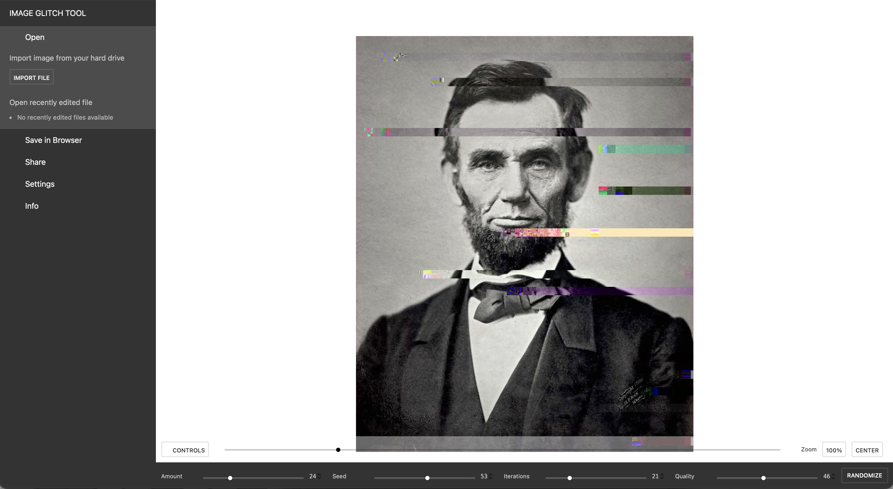
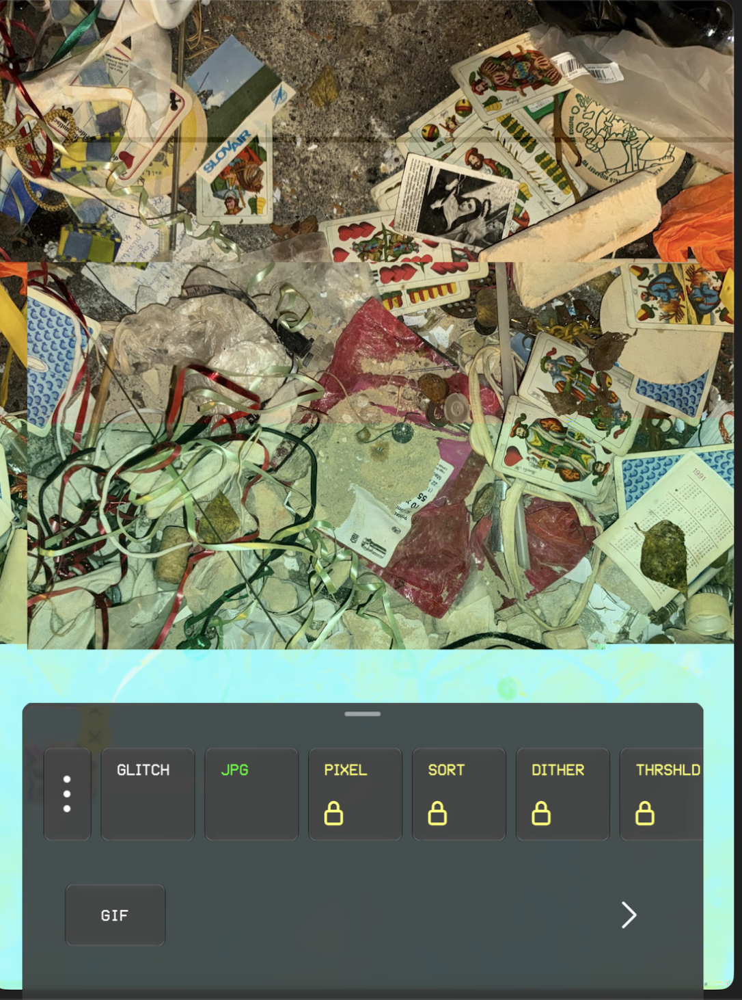
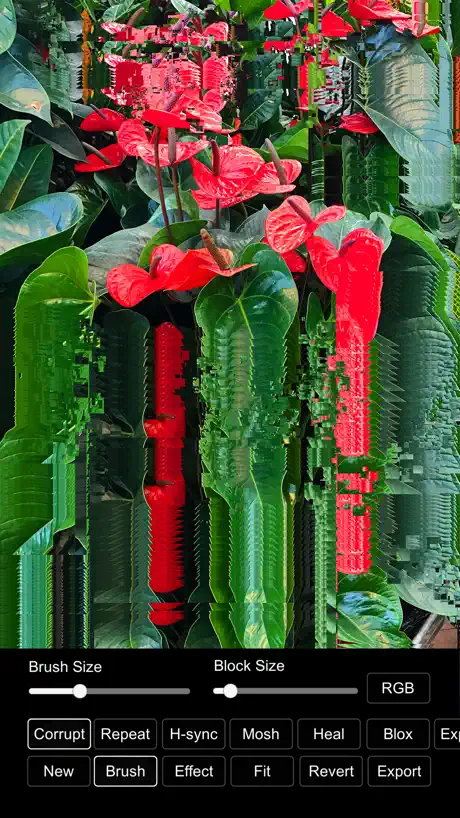
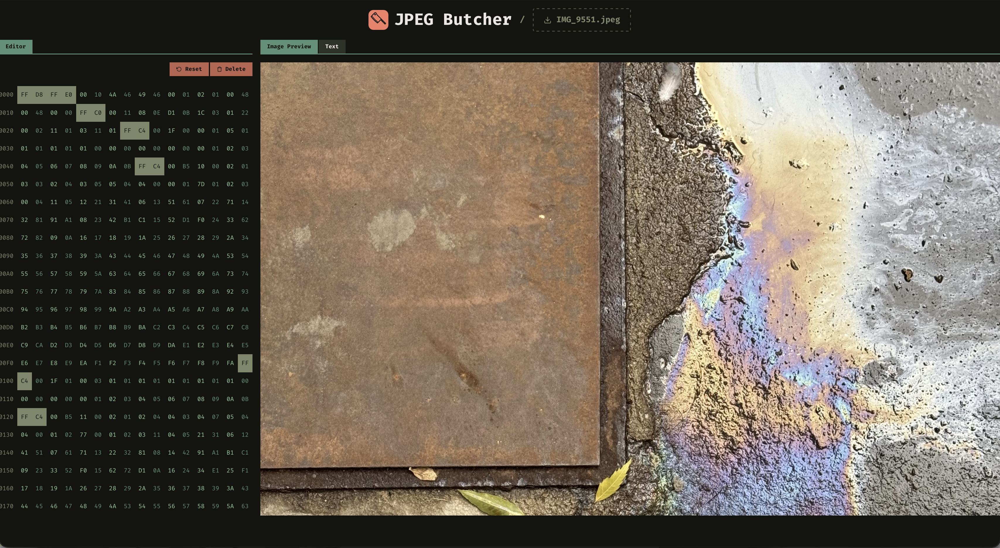
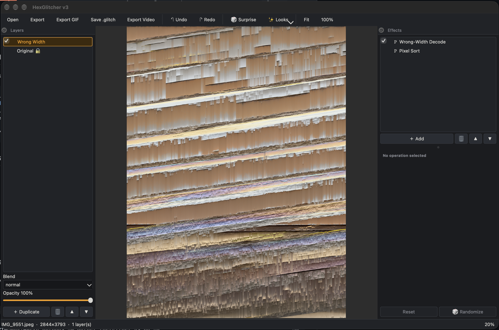
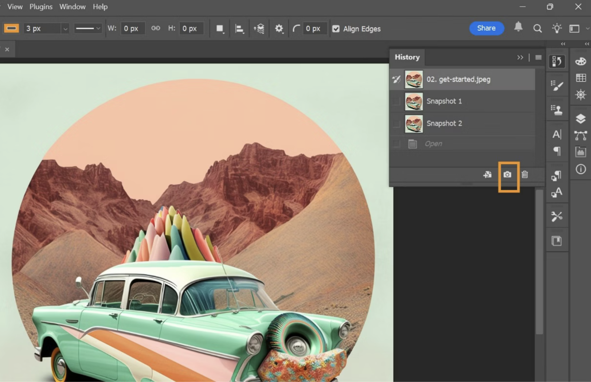
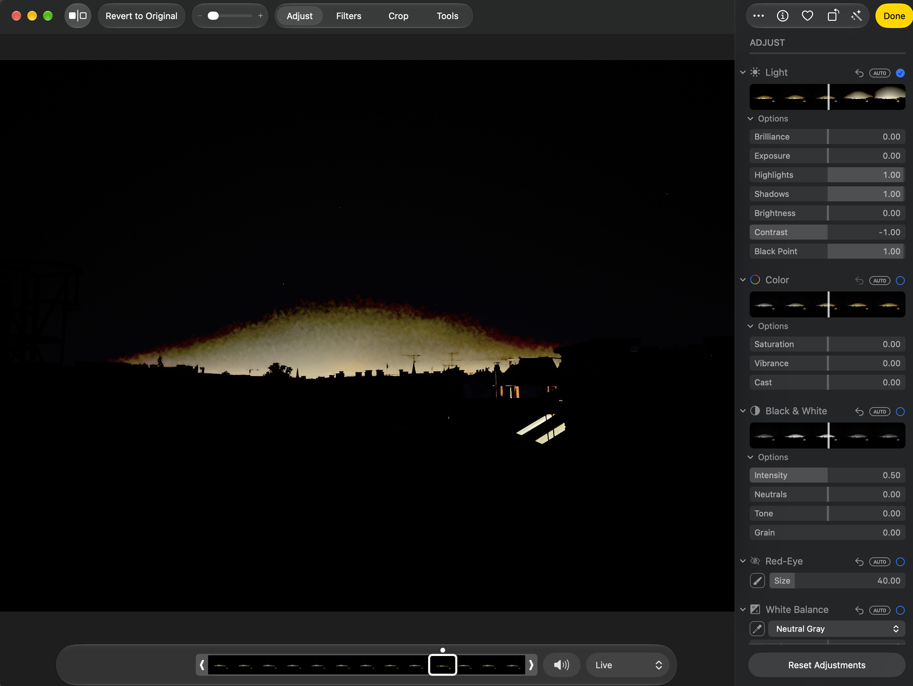
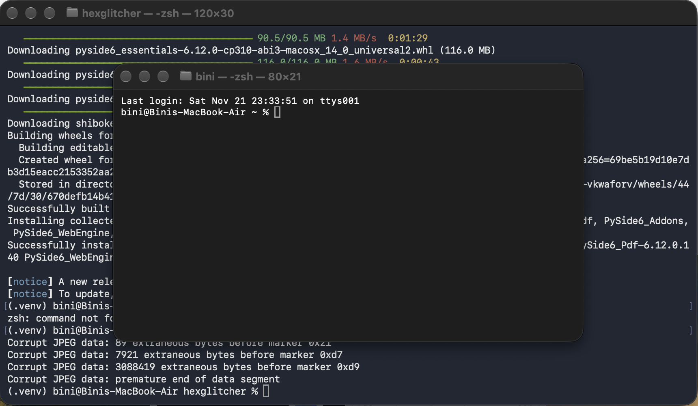
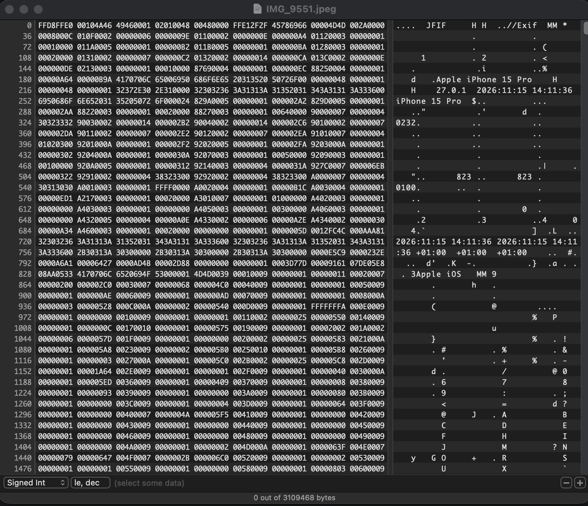
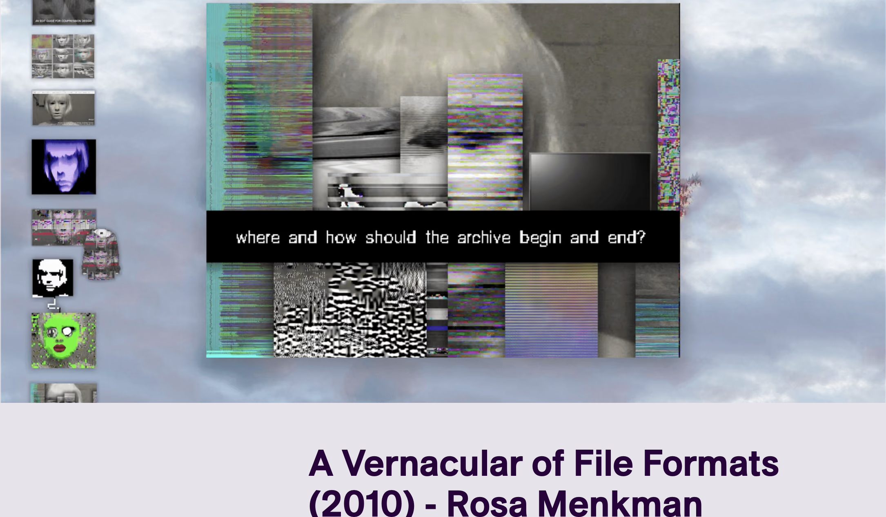

# References

**AI use:** Claude helped me find glitch tools on the internet.

## Competitors (4)

### 1. JPG Glitch by snorpey (web app)

- Link: https://snorpey.github.io/jpg-glitch/
- Take: It really corrupts the JPEG data and the file still opens, and you start by just dropping a picture in. That is the same promise as Image Bender.
- Avoid: It is super limited compared to my project, it only offers one of Image Bender's features, Shatter, and the interface is very bare bones. Image Bender has many more tools and a UI that is minimal but finished.

### 2. Glitché (iOS)

- Link: https://apps.apple.com/app/id634467171
- Take: It has a similar minimalistic interface and a very short way from opening a photo to a glitched result, which is what makes people try glitch art in the first place.
- Avoid: Most of the features are behind a subscription, and it uses filters and effects (some with AI) instead of real data editing and corruption. Image Bender uses no AI and corrupts the actual file data.

### 3. DestroyPix (iPhone app)

- Link: https://apps.apple.com/us/app/destroypix/id1454410349
- Take: You paint the glitch onto only the parts you choose and a Heal brush brings the original back, so people clearly want control over where the damage goes. That is the idea behind my Coverage setting and safe zones.
- Avoid: It has not been updated in about 8 years, so it feels outdated, and it only offers a small number of features that are not very advanced or technical. Image Bender is a Mac app with much more advanced controls.

### 4. jpeg-butcher (web app)

- Link: https://github.com/saschazar21/jpeg-butcher
- Take: The interface is very minimalistic, and its loop is change a byte, look at the picture, reset if it went too far. That is the simplest version of what Image Bender does.
- Avoid: It is not user friendly, because you have to work with the hex code directly and use a sheet from GitHub. Image Bender is easy to use and still lets you edit the hex if you want to.

## Patterns (3)

### 5. Adjustable header protection ("Safe Zone") in hexglitcher

- Link: https://github.com/willbearfruits/hexglitcher
- Take: It protects the start of the file from corruption so the file stays valid. This is the same idea as Image Bender's locked safe zones and shows that people need this control.
- Avoid: The Safe Zone is a number of bytes (the page gives "the first 500 bytes" as an example), so you have to already know how big the header is, and it does not run on Mac. Image Bender names the protected parts in plain words and runs on Mac.

### 6. History panel and snapshots in Adobe Photoshop

- Link: https://helpx.adobe.com/photoshop/desktop/get-started/set-up-toolbars-panels/create-work-snapshots.html
- Take: Every change is its own step that you can click to go back to, and snapshots let you keep a version to compare. This is the pattern behind Image Bender's History tab.
- Avoid: Snapshots only last until the document is closed, so a glitch you liked can get lost. In Image Bender a good result should be easy to keep, as a macro or as an exported copy.

### 7. "Hold to see the original" in Photos on Mac

- Link: https://support.apple.com/en-za/guide/photos/pht304c2ace6
- Take: While you edit, you click and hold a button (or hold the M key) to see the original, and let go to see your edits again. Image Bender's Hold to compare works the same way.
- Avoid: In Photos it only works in edit mode and does not show changes made by cropping. Image Bender's compare should work whenever an image is open and show the whole change.

## Visual (3)

### 8. Terminal (Mac)

- Link: https://support.apple.com/guide/terminal/trmld4c92d55/mac
- Take: It is a plain window with a prompt and text on a black or white background, with no buttons or menus in the way. Image Bender's black and white interface follows the same idea of minimalism.
- Avoid: Apple describes it as an app for advanced users and developers, so a beginner gets very little help. Image Bender keeps the minimal black and white look but has clearly labelled tools in plain language.

### 9. Hex Fiend (Mac hex editor)

- Link: https://apps.apple.com/us/app/hex-fiend/id1342896380?mt=12
- Take: It is a plain, native Mac tool with a dense hex view and a data inspector. That is the practical look I want for Image Bender's Hex tab.
- Avoid: It is made for developers and forensic analysts and uses terms like big and little endian without explaining them. Image Bender should use plain-language labels.

### 10. "A Vernacular of File Formats" by Rosa Menkman (2010)

- Link: https://beyondresolution.info (summary: https://li-ma.nl/article/vernacular-of-file-formats-summary)
- Credit: Rosa Menkman
- Take: One self-portrait is corrupted through different file formats, and each format breaks in its own recognisable way. This is the kind of varied, real corruption Image Bender should make, and it shows why the file type matters.
- Avoid: It is a finished artwork, not a tool, and it shows the glitch as one fixed look. Image Bender leaves the look to the user.
