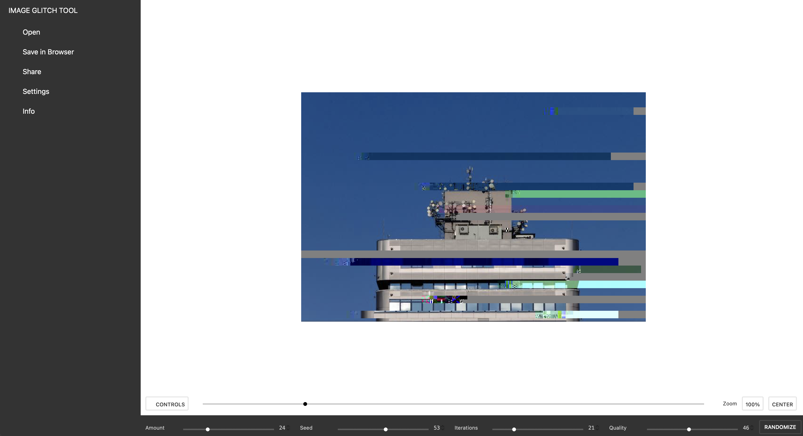
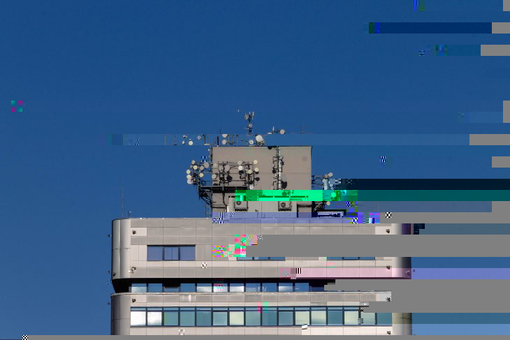
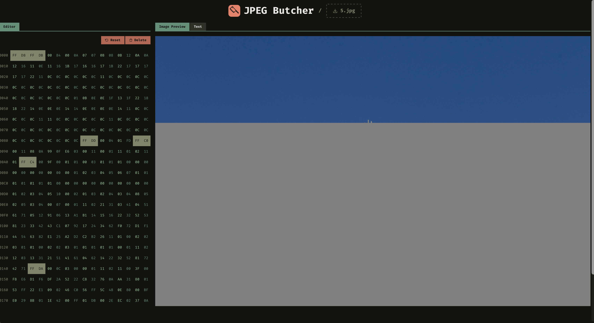
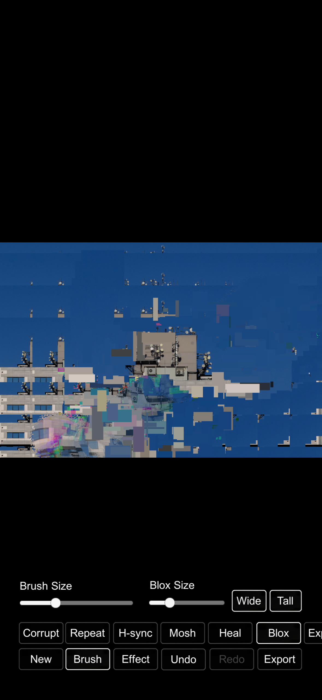
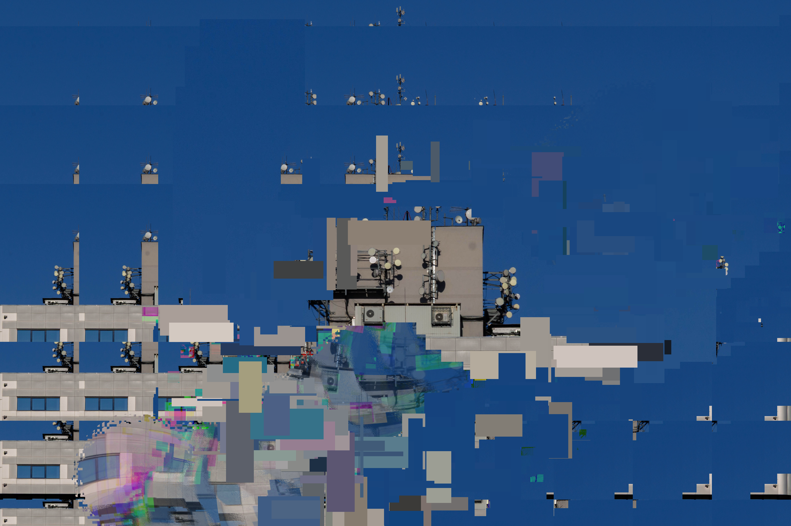

# Step 2 · Benchmark

Main task, phrased as a goal: I want to corrupt an image and export it so that it still opens.

I tested three competitors on the same task with the same criteria. I counted every click from the first screen to the finished export and took a screenshot of each step (`img/`).

## Comparison table

| Criterion | 1. JPG Glitch (web) | 2. jpeg-butcher (web) | 3. DestroyPix (iPhone app) |
|---|---|---|---|
| Steps from start to goal | 4: press Open, choose an image, move the sliders, export from the menu bar | 5 if it works: drop the file or click to choose it, scroll the hex down past the header, type a new byte value, check the preview, then try to save it with the download button or by right-clicking the preview. Both gave me the original image, so I never reached the goal | 5: tap New and pick a photo, choose a brush (Corrupt, Repeat, H-sync, Mosh, Heal or Blox), set the brush size, drag a finger over the image, tap Export |
| 3 things that work | 1. Opening an image is one button 2. The corruption is real and the exported file still opens 3. Export is a plain download from the menu bar | 1. Importing is simple: drag the file onto the page or click the area to choose one 2. The preview updates as soon as a byte changes 3. A Reset button brings the original back | 1. It is free, simple and has no paywall 2. Several glitch brushes in one row, and the effects look interesting 3. The exported image keeps the full size (4070 x 2713) |
| 3 things that fail | 1. It scales the image down (Image Bender keeps the original size) 2. Only four sliders, so you cannot choose the direction of the corruption 3. No new commit in about 8 years, so it is not maintained | 1. It looks simple, but editing is hard and nothing guides you. The editor opens on the header, so one wrong byte turns the preview black or gray 2. The dashed download button at the top saves the original image, not my edit 3. Right-click and save on the preview also gave me the original, so I could not export the glitched image at all | 1. You paint with a finger, so it is hard to control and it feels unresponsive 2. Not updated in about 7 years and not adapted to newer iPhones: the buttons are too small and the brush row is cut off at the screen edge 3. I cannot tell if the brushes really corrupt the image data or are just a filter |

Note on DestroyPix: the App Store lets it install on Apple silicon Macs as an iPhone app, but when I tried it on my Mac, importing an image failed. In practice it only works on an iPhone.

## Screenshots
I used the same test image for every competitor, so the results can be compared directly. For each one I show the process (the tool while I work) and the result (the exported file).

### 1. JPG Glitch
Process:

Result:

### 2. jpeg-butcher
Process:

Result (the preview after my edit; both the download button and right-click save gave me the original image instead):

### 3. DestroyPix
Process:

Result (the exported image):

## Patterns to reuse
- **Start with one action.** JPG Glitch has an Open button, jpeg-butcher takes a dropped file, DestroyPix has New. Image Bender should get an image open in one step.
- **Show the change right away.** In JPG Glitch and jpeg-butcher the picture updates as soon as something changes, so you learn by trying. The preview should stay live.
- **Always give a way back.** jpeg-butcher has Reset and DestroyPix has Undo, Redo and Heal. A bad edit should never cost the whole session.
- **Keep Export in plain sight.** DestroyPix has an Export button that is always visible and JPG Glitch has it in the menu bar. Export should be easy to find and should save exactly what is on screen.
- **Group the corruption types by name.** DestroyPix puts Corrupt, Repeat, H-sync, Mosh, Heal and Blox in one row. A short row of clearly named tools is easy to scan.

## Gaps nobody solves
- **Nobody protects the file itself while you corrupt it.** In jpeg-butcher one wrong byte in the header gives a black or gray picture. JPG Glitch and DestroyPix have no way to mark parts of the file that must never break (DestroyPix only lets you choose where to paint). None of the three has anything like a safe zone.
- **Too little control or too much, and nothing in between.** JPG Glitch has four sliders and nothing else. DestroyPix is a finger on a small screen. jpeg-butcher is raw hex with no explanation. Nobody offers precise control in plain language.
- **Nobody explains what a change does to the file.** In jpeg-butcher you cannot tell which bytes matter. In DestroyPix I could not tell if the brushes corrupt the data or just apply a filter.
- **Getting the finished file out is unreliable.** JPG Glitch exports a smaller image. jpeg-butcher gave me the original image back from both the download button and right-click save. Only DestroyPix exported at full size.
- **There is no good Mac option.** JPG Glitch and jpeg-butcher are websites, and DestroyPix is an iPhone app that failed to import an image on my Mac.

## How Image Bender fixes these issues
| Competitor | Issue I found | What Image Bender does |
|---|---|---|
| JPG Glitch | Scales the image down, only four sliders | Keeps the original size and has many more tools, Shatter is only one of them |
| jpeg-butcher | One wrong byte in the header gives a black or gray picture | Locked safe zones protect the parts of the file that must not break, so the file still opens |
| jpeg-butcher | Raw hex with no guidance | Plain-language labels, and the Hex tab is there if you want to edit bytes yourself |
| jpeg-butcher | Cannot export the edited image | Exports the corrupted image so it still opens, which is the main task |
| DestroyPix | Finger painting is hard to control | Settings you choose exactly, for example Coverage, instead of painting by finger |
| DestroyPix | Unclear if it corrupts or filters | Every effect is a mechanical corruption of the file data, with no filters and no AI |
| DestroyPix | Old, buttons too small, no Mac version that works | A Mac app with clearly labelled tools |

## AI use
Claude helped set up this table and the outline for the md file. I did the testing, counted the steps and wrote the findings myself.
