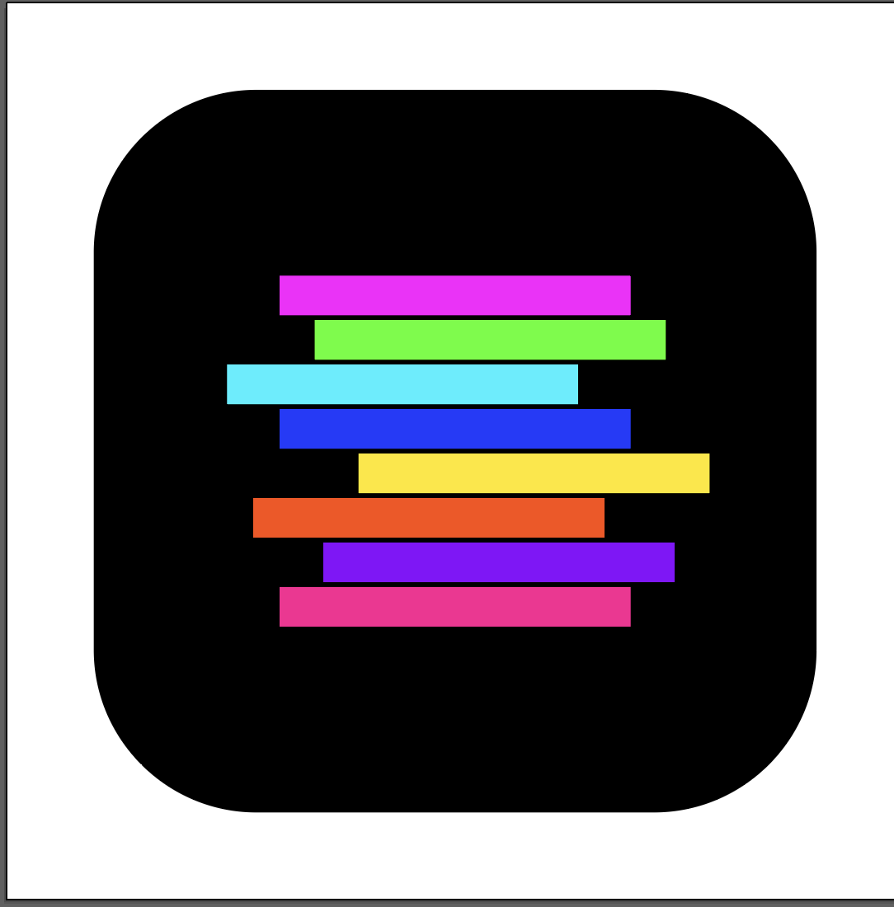
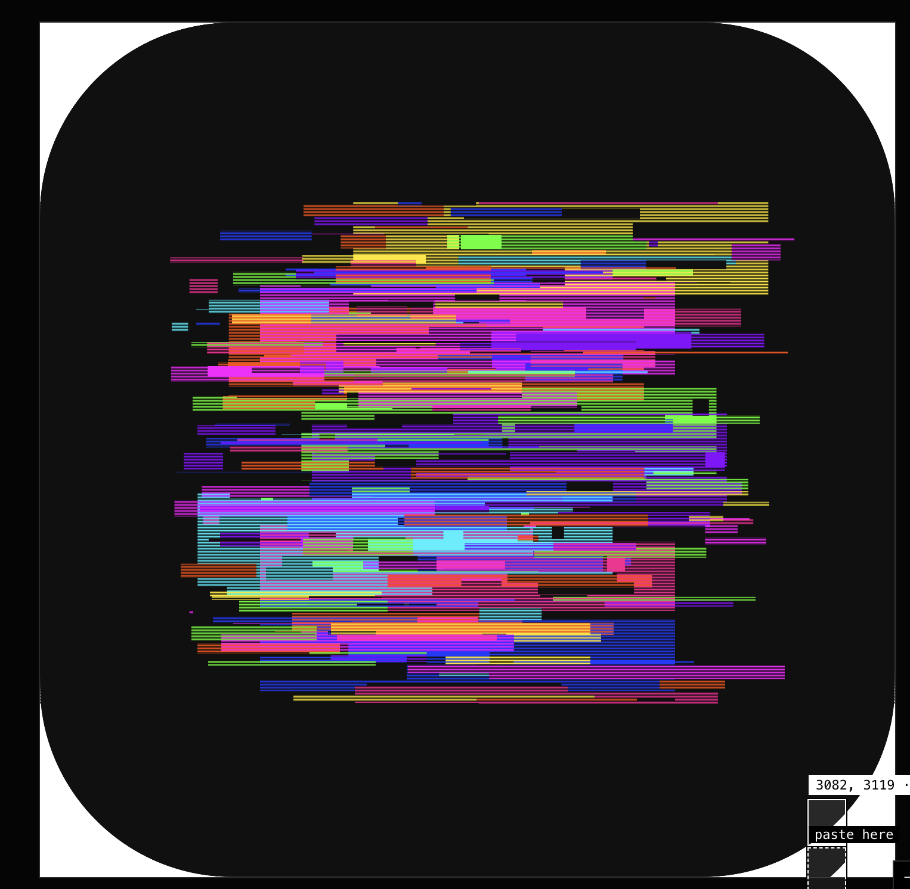
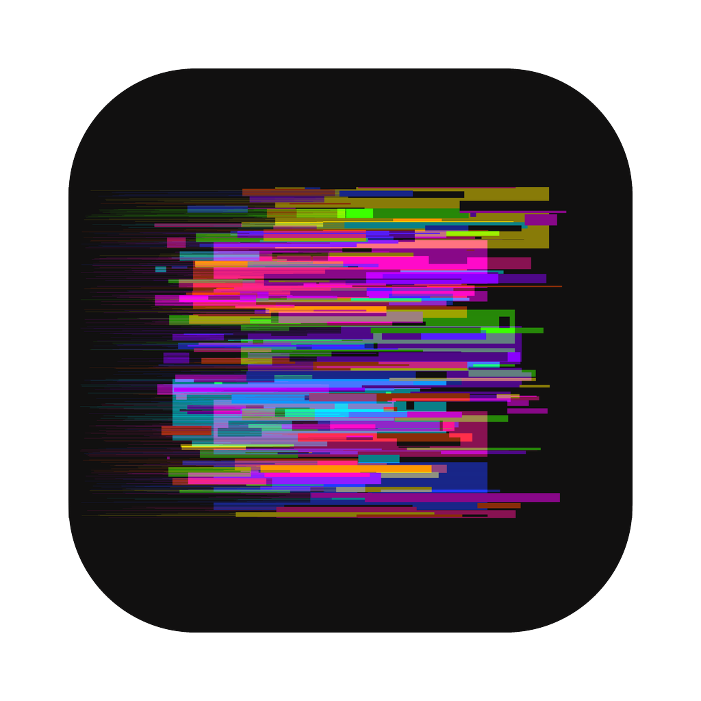

# App icon: how I made it

The icon for Image Bender was drawn in Adobe Illustrator and then corrupted with Image Bender itself.

## 1. First version in Illustrator
A black rounded square with eight white strips cut from a square, each strip shifted sideways and coloured with a corruption colour (magenta, green, cyan, yellow and others). It looked too neat, like a bar chart, and the mark was too small.

## 2. Glitched with Image Bender
I ran the design through my own app. The result looks like real file corruption: smeared bands, broken colours and dark gaps, which is more convincing than the clean strips.

## 3. Final icon
I made the corners transparent and put the tile on a 1024 x 1024 canvas with the usual margin around it, so it looks right in the Mac Dock. This file is used as the app icon (`app/build/icon.png`) and as the logo at the top of the README.

## Source file
The Illustrator file is `logo-bent.ai` in this folder.

## AI use
I drew and corrupted the icon myself. Claude gave tips on the icon size, the layout steps and a list of corruption colours.
