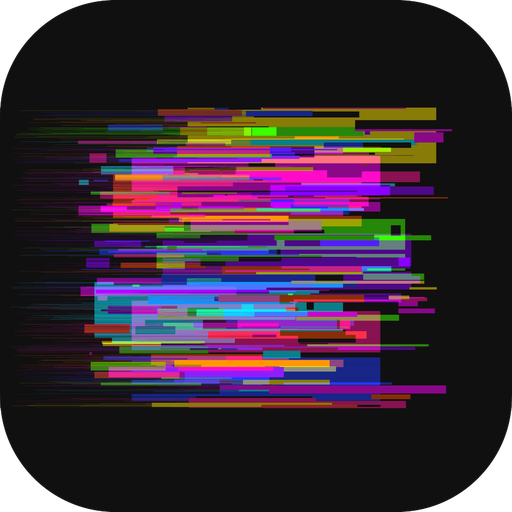

# Image Bender: a Mac app for corrupting images by hand without breaking the file

- Student: Luka Biniashvili
- Platform: macOS desktop (Electron app)
- Figma design file: https://www.figma.com/design/pcAjQoWQ1kEq07wu0OsP3W/ux-project-image-bender
- FigJam research board: (added in Step 2)
- Prototype: (added in Step 6)
- Download (Mac, Apple silicon and Intel): [latest release](https://github.com/socialistmonkey/UX_Project/releases/latest)
- App code: [app/](app/) (the Image Bender project version, run with `npm install` then `npm start`)

## The idea in one sentence
Image Bender lets glitch artists corrupt an image byte by byte and lock safe zones so the file still opens, for when preset filters feel fake and databending by hand keeps destroying the file.

## Status
- [x] Step 1 · Idea and references (due: session 2)
- [ ] Step 2 · Benchmark and interviews (due: session 3)
- [ ] Step 3 · Insights, persona, journey map, problem (due: session 4)
- [ ] Step 4 · Concept, sitemap, user flow, wireframes (due: session 5)
- [ ] Step 5 · UI kit, screens, heuristic review (due: session 6)
- [ ] Step 6 · Prototype, test, case study (due: final review)

## AI use (whole project)

Tool: Claude (Anthropic). Every step file also says where AI was used.

- Step 1: Claude helped me find glitch tools for the references and tidied the wording of idea.md and this README. I opened every link, took every screenshot and decided what goes in each Take and Avoid.
- Figma file: Claude helped draft the first UI kit, screens and wireframes. I will check and change them in Steps 4 and 5.
